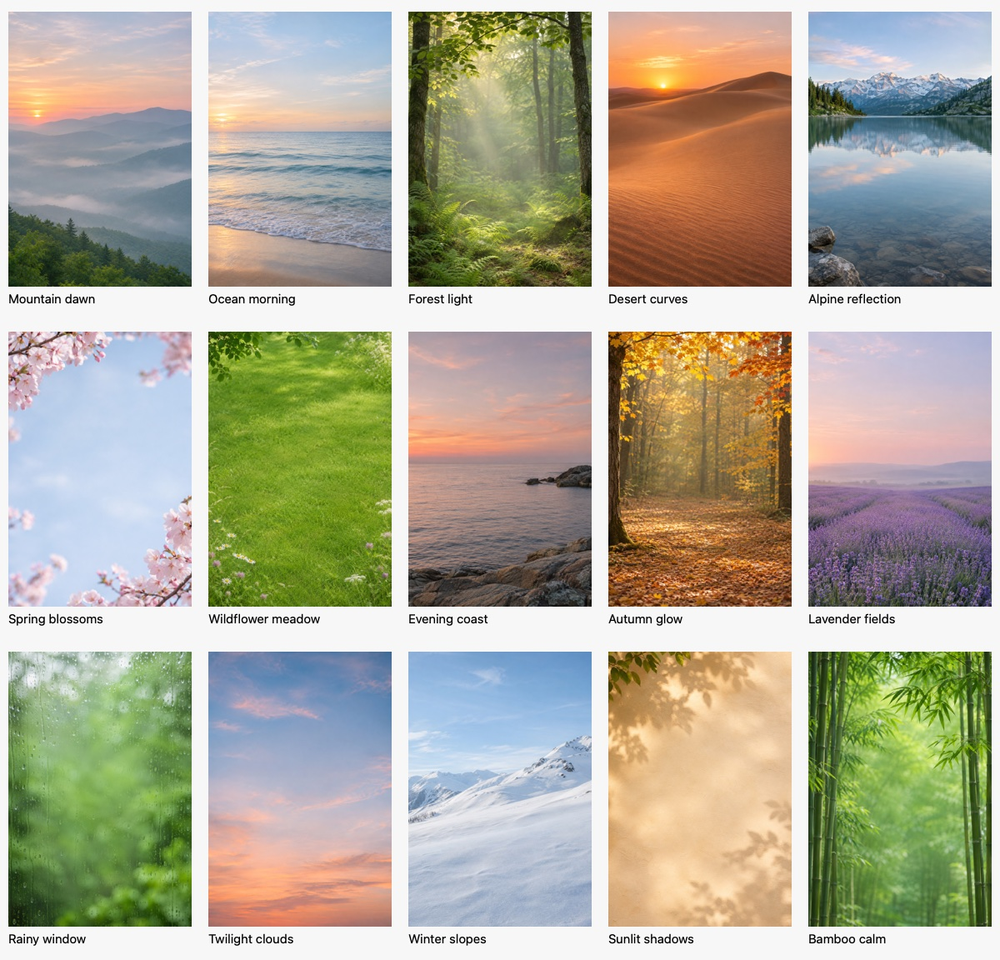

# Card background portfolio

Created November 8, 2026 with the built-in image_gen tool, one generation per image. These are AI-generated photographic backgrounds, bundled for offline use; no personal Photos library access is involved.

## Assets and prompts

Final assets live in `Src/Assets.xcassets/CardBackground01.imageset` through `CardBackground15.imageset`, each with `background.jpg` and its asset-catalog manifest. The generated PNGs were converted to JPEG at quality 86 for bundling. The image set totals about 6.3 MiB before asset-catalog packaging.

Each prompt requested a single photographic background for Cards and Notes, portrait 2:3, a quiet uncluttered center behind text, natural texture, restrained contrast, and an edge-to-edge image with no text, lettering, logos, frames, collage, or UI. The first scene used serene dawn light and atmospheric depth; the remaining prompts requested polished photographic realism.

| Asset | Name | Scene prompt |
| --- | --- | --- |
| CardBackground01 | Mountain dawn | distant misty mountains at dawn, soft natural light, subtle atmospheric depth |
| CardBackground02 | Ocean morning | Gentle ocean waves and a distant horizon under soft morning light |
| CardBackground03 | Forest light | A quiet sunlit forest with soft ferns and atmospheric depth |
| CardBackground04 | Desert curves | Warm sand dunes with flowing curves at sunrise |
| CardBackground05 | Alpine reflection | A still alpine lake reflecting distant mountains |
| CardBackground06 | Spring blossoms | Soft cherry blossoms at the edges against a quiet out of focus sky |
| CardBackground07 | Wildflower meadow | A green meadow with delicate wildflowers at the edges |
| CardBackground08 | Evening coast | A quiet rocky coastline in muted evening light |
| CardBackground09 | Autumn glow | Golden autumn woodland with softly glowing leaves |
| CardBackground10 | Lavender fields | A tranquil lavender field receding toward a hazy horizon |
| CardBackground11 | Rainy window | Rain droplets on a window with softly blurred greenery beyond |
| CardBackground12 | Twilight clouds | A cloudscape with soft peach and blue twilight |
| CardBackground13 | Winter slopes | Snowy mountain slopes beneath a pale blue winter sky |
| CardBackground14 | Sunlit shadows | Sunlight making soft leaf shadows on a warm plaster wall |
| CardBackground15 | Bamboo calm | A peaceful bamboo grove in soft diffused daylight |

## Behavior

Cards and Notes can choose any image in Appearance → Background artwork → Background portfolio. The editor retains its existing preview, readability, framing, Save, and Cancel flow. Each new Note without an explicit or configured Studio surface receives the next image in the fixed portfolio order; the rotation wraps after 15. A saved Note retains that photo when reopened or moved. Existing Notes are not repainted, Cards keep their prior creation behavior, and dividers receive no artwork.

Plan Settings → Appearance → Plenact Studio → New item backgrounds can override the new Note default. An explicit Plain surface creates Notes without artwork; removing the override resumes rotation. The next-photo cursor uses a separate device-local preference, `Plenact.NoteBackground.Next.v1`, and is not added to shared appearance or export settings.

Selecting a bundled image first writes its immutable JPEG into `PlenactStudioArtwork`. The saved surface uses the existing `.photo` material and `photoFileName` fields, so native backups and the existing artwork export paths can include the actual image bytes. This feature adds no portable schema fields or materials and does not expand previously documented migration guarantees. Cancelling a draft may leave a reusable local image or consume a rotation position; saved content is unchanged.

## Verification

Focused native tests cover all 15 bundled images, unique sequence and wraparound, reopened rotation preferences, failed preparation without cursor advancement, photo encoding/decoding, Note creation, explicit Plain preference, repeat application, and unchanged Card defaults. Existing Studio creation-default and material round-trip tests are also included in the focused run.

