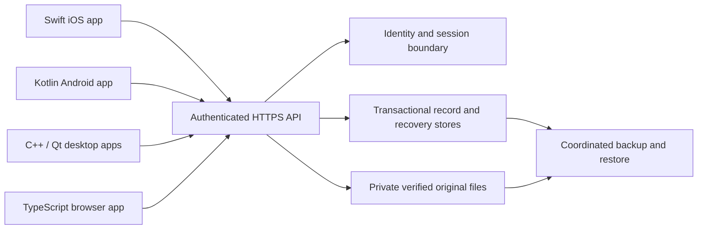

# Plenact connected, offline-first, multiplatform roadmap

**Updated:** November 8, 2026  
**Owner:** Justin Reina  
**Purpose:** Reference plan for connecting Plenact to a private Bluehost-hosted service and delivering compatible mobile, desktop, and web applications  
**Current checkpoint:** Step 1 closed for the bounded local beta; Step 2 synthetic backend staging is next  
**Activation boundary:** This document does not deploy a service, enable synchronization, publish a contract, or authorize uploading personal data

## 1. The intended product

Plenact should let Justin plan, write, organize, and review on the device that fits the moment, with the same owned content available across supported devices. The first connected product serves one authenticated owner and one private workspace. Shared teams, public workspaces, and a public user directory are not prerequisites for that product.

Each installed application must remain useful indefinitely without a connection. A saved local edit must survive an application restart and later be reconciled with the service. A disconnected device, expired session, expired change cursor, or temporarily unavailable host must not cause the application to discard writing or silently replace it with a server copy.

The backend supplies a common authenticated record and media service. It does not dictate identical screen layouts. The iPhone, desktop, Android, and browser interfaces can suit their own input methods while preserving the same identities, relationships, authored values, and synchronization guarantees.

Our delivery priority is a useful, supportable product in bounded increments. We do not need every platform, editing adapter, or future collaboration feature finished before proving the first connected workflow. We do need an honest supported scope, recoverable data, and evidence that the selected workflow works.

## 2. The four steps

| Step | Objective | Required result | Current status |
| --- | --- | --- | --- |
| 1. iOS migration and export | Establish the portable model and safely preserve, convert, import, edit, export, and recover supported iOS data | Verified local packages and recovery, with unsupported operations identified | Bounded local beta closed; production migration gates remain |
| 2. Bluehost backend staging | Implement authenticated persistence and the shared API using isolated synthetic data | Running staging service with tested authorization, atomic writes, retries, snapshots, media, and restore | Next major phase; no current private-model deployment is established by this roadmap |
| 3. iOS synchronization | Connect normal iOS editing to durable offline synchronization | Local transactions/outbox, pull/reconciliation, explicit conflicts, verified media, and recovery | Planned; cloud synchronization remains disabled |
| 4. Additional clients | Connect desktop, web, and Android through the same tested contract | Compatible clients that pass common data and operational acceptance checks | Technology directions selected; integrations remain planned |

These steps describe dependencies, not four equally sized tasks or completion percentages. Synthetic client prototypes can begin before the whole service is finished, but they cannot claim production synchronization until the relevant contract and recovery gates pass.

### What “Step 1 complete” means

The owner explicitly accepted a **bounded beta closeout**, rather than requiring every possible iOS operation to become portable before backend work could start. That decision is recorded in [Step 1 beta closeout](User-Data-Model/Step-1-Beta-Closeout.md).

It means the reviewed local migration/export workflow is sufficient to support the next phase of synthetic development. It does not mean arbitrary future native stores, every deletion/transfer path, physical-device migration, authenticated ownership, or production synchronization have been certified.

### What “ready for Step 2” means

We can build and test a private-workspace backend with synthetic owners, records, and media. We do not need another round of the already accepted v25 manual migration test to begin that work. Personal-data upload, live service replacement, or activation of production synchronization requires its own reviewed transition.

## 3. Decisions and boundaries

| Topic | Recorded direction | Practical consequence |
| --- | --- | --- |
| Initial owner | Justin Reina | Keep the first private product focused; still enforce owner authorization server-side |
| Ownership | Verified stable account UUID and explicit workspace association | Display name, profile email, device ID, or possession of a ZIP cannot grant ownership |
| Offline use | Indefinite, without application-imposed expiry | Retain committed local data, pending work, and owned originals while network operations are unavailable |
| Shared preferences | Follow the user by default | Maps choice, appearance, planning intent, and shortcuts belong in the shared model where supported |
| Device-only state | Explicit exceptions | Credentials, OS permissions, viewport, transient navigation, unfinished drafts, and recovery machinery stay local |
| Hosting | Bluehost is the planned host | Audit the actual plan and capabilities before selecting deployment details |
| Backend language | PHP is the provisional starting direction | Confirm runtime and operational suitability; it is not a reason to weaken the contract |
| Server database | MySQL-compatible transactional persistence is planned | Prove locking, atomicity, identity uniqueness, and restore behavior on the actual engine |
| Desktop | C++ with Qt for Windows, macOS, and Linux | Supersedes the earlier C# Windows, Swift Mac, and gtkmm Linux proposals |
| iOS | Swift/SwiftUI with existing UIKit integrations | Continue the existing application; no rewrite is required |
| Android | Kotlin/Jetpack Compose is the planned direction | Validate with a focused prototype when that client begins |
| Browser | HTML/CSS and TypeScript, running as JavaScript | Implement the same data semantics with browser-specific persistence and session protections |
| Contract publication | GitHub is the first publication destination | Release documentation, schemas, fixtures, and evidence together when explicitly authorized |

See [platform languages and desktop architecture](../../Lessons/Platform-Languages-and-Desktop-Architecture.md) for the alternatives, learning costs, and desktop cost/benefit analysis. Qt Quick/QML is the preferred initial desktop interface prototype, not a fully validated release configuration. Qt modules, licensing/distribution choices, compiler baseline, packaging, and supported OS versions still require a concrete implementation decision.

## 4. Which documents govern what

This roadmap summarizes delivery and records the current direction. It does not replace the normative data or protocol contract.

| Reference | Authority or use |
| --- | --- |
| [Model specification](User-Data-Model/Specification.md) | Canonical content, ownership, record relationships, and model scope |
| [Protocol 1.0](User-Data-Model/Synchronization.md) and [OpenAPI](User-Data-Model/Contracts/1.0/openapi.json) | Exact private API behavior and machine-readable routes |
| [Logical storage](User-Data-Model/Logical-Storage.md) | Transactional persistence and retention invariants |
| [Assets](User-Data-Model/Assets.md) | Original bytes, verification, resumable transfer, and explicit purge |
| [Lifecycle](User-Data-Model/Data-Lifecycle.md) | Ownership, account deletion, retention, and restore obligations |
| [Compatibility](User-Data-Model/Compatibility.md) and [date rules](User-Data-Model/Date-and-Compatibility-Rules.md) | Version negotiation and equivalent interpretation across clients |
| [Working Model 1.1](User-Data-Model/Version-1.1.md) | Additive appearance/artwork composition and pending local Card deletion intent |
| [Step 1 closeout](User-Data-Model/Step-1-Beta-Closeout.md) | Bounded acceptance, source exclusions, deferred adapters, and handoff |
| [Integration plan](User-Data-Model/Integration-Plan.md) and [editable import](User-Data-Model/Editable-Import.md) | Chronological implementation and acceptance evidence |
| [MySQL plan](../../Database/Model-1.0-MySQL-Plan.md) | Proposed physical storage responsibilities; not deployed production DDL |
| [Server source overview](../../../Server/README.md) | Historical Version 0 runtime and deployment record |
| [Platform decision](../../Lessons/Platform-Languages-and-Desktop-Architecture.md) | Current language/toolkit direction |

Some older overview documents still describe the original C# Windows proposal or early partial migration states. Their dates and historical evidence remain useful; those implementation statements must be read alongside the later platform decision and beta closeout. An older “pending” paragraph is not evidence that a subsequently accepted adapter is still absent.

If current behavior and a normative contract disagree, record the discrepancy and resolve it explicitly. Do not silently modify a released schema or weaken a service guarantee to match an implementation shortcut.

## 5. Versioning and existing infrastructure

### Published Model 1.0

[User Data Model 1.0](https://github.com/Plenact/Plenact/releases/tag/user-data-model-v1.0) is the immutable published base. Its release contains the base specification, 24 canonical record types, 48 schemas, synthetic examples, and conformance material. A published definition does not establish that a corresponding production API or client has been deployed.

Changes needed by current implementation must not be patched into the frozen `Contracts/1.0` namespace or existing release tag.

### Working Model 1.1

Working 1.1 composes an unchanged 1.0 base with explicit appearance and artwork-library records, plus a pending local Card-deletion overlay. It remains unpublished. It does not silently upgrade the Protocol 1.0 API registry or transport.

Backend staging must pin a specific contract set and declare exactly which record streams it can transport. A base-only synthetic service is a reasonable first slice, but it must reject unsupported composite packages rather than stripping their extra semantics. A later complete personal-workspace pilot needs an explicitly supported, reviewed representation of all required 1.1 data and deletion intent.

The local deletion overlay is **not** a server tombstone, accepted transaction, acknowledged revision, or durable synchronization outbox. Translating it into a real authenticated delete requires explicit ownership, current revisions, reference handling, and an accepted server transaction.

### Version 0 shared demo

Repository records describe an earlier synthetic shared-Board PHP/MySQL demo, deployed in October 2026. Its wire `schema_version: 1`, SQL migration `001`, and local `.v1` keys are historical namespaces. They do not mean User Data Model 1.0 support.

The historical demo is not the private-workspace service we are about to build. Do not rerun migration `001`, replace its database, repurpose its session tokens, or treat its deployment record as a fresh host audit. Keep its routes, data, credentials, and storage separate from new staging resources.

### Independent version numbers

Keep application versions, user-data-model versions, payload schemas, protocol versions, database migrations, record revisions, change sequences, and workspace epochs distinct. They solve different compatibility and recovery problems. Increasing an app build number cannot authorize a lossy model downgrade or repair an old-epoch request.

## 6. Current verified checkpoint

The migration/export branch endpoint is commit **`9d0fe867504acddb9ac2e3772da84b4503212399`**, “Extend verified portable export for templates and shortcuts.” Later UI and code-style refinements continued on `main`.

The accepted owner-operated checkpoint is **v25**. Its reviewed package contained 430 reviewed records, 257 nondeleted Cards, 44 Lists, and five verified original files. Stored canonical records can include retained deletion targets, so visible nondeleted counts need not equal total stored Card records.

Evidence at that migration closeout included **80 affected native tests** and **112 tooling tests**, independent synthetic package checks, and owner-operated export/re-import acceptance through v25. Two previously isolated keyboard-focus tests were excluded from that broad native run. These are dated suite results, not a claim that every present application test has been rerun or every platform certified.

Supported local work includes reviewed content/media conversion, protected editable import, retained pre-import backup and Undo, supported Card/List/Collection metadata and content edits, bounded rollover/template operations, profile/Studio personalization, shared preferences, planning/review writing, and owner-qualified shortcuts. Exact support depends on the current adapters and documented operation boundaries.

Personal v25 archives and recovery history are private evidence. They must not be uploaded to synthetic staging, copied into repository fixtures, or published on GitHub. The synthetic account `f0000000-0000-4000-8000-000000000001` is test identity, not an authenticated claim to Justin's personal cloud workspace.

### Deferred portability work

The closeout explicitly leaves these categories for concrete later workflows:

- Cross-Board transfers and other owner-changing operations with linked-reference consequences.
- Retained List/Week/Collection deletion and arbitrary Collection creation outside supported paths.
- Changed first-weekday policy, some retained calendar mappings, and cross-Week checklist overrides.
- Remaining template context/weekday/focus changes and reference-dependent lifecycle operations.
- Label/category and other subsequent edits without a verified reconciliation adapter.
- New drawing derivations, changed previously verified original bytes, and broader format/version coverage.
- Authenticated real account/workspace binding and production migration/recovery acceptance.

Later local UI improvements do not automatically expand the portable exporter. For example, the four-second Library deletion Undo is local application behavior; it does not establish a portable Collection-deletion adapter or server tombstone support. Keep unsupported-change guards until the corresponding adapter and tests exist.

## 7. Target architecture



Each client owns a local persistence boundary beneath its interface. The intended layers are:

1. **Presentation:** screens, interaction, accessibility, and platform lifecycle.
2. **Application/domain behavior:** editing operations, validation, references, and user intent.
3. **Durable local state:** records, base versions, pending edits, conflict copies, cursors, and original files.
4. **Synchronization:** immutable requests, retry, pull, reconciliation, and media-transfer state.
5. **Transport:** authenticated HTTPS and capability negotiation.

The server owns authorization, accepted revisions, change sequencing, deduplication receipts, snapshot consistency, verified remote-byte status, and operational recovery. No app connects directly to MySQL. SQL credentials and private file locators do not belong in mobile/desktop apps, browser bundles, user records, or exports.

Shared meaning matters more than shared implementation language. Swift, Kotlin, C++, TypeScript, and PHP can implement one contract without copying the iOS UI or native storage representation into every client.

## 8. Step 2: Bluehost staging

### 8.1 First task: read-only environment inventory

Inspect the actual hosting environment before choosing deployment paths or creating resources. Record dated findings and redact secrets. Historical runtime/version notes are starting evidence only.

| Area | Questions to resolve |
| --- | --- |
| Hosting access | Which plan/account is authorized, and which operator access is available? |
| Runtime | Which PHP versions/extensions, CLI facilities, request/body limits, and execution limits are available? |
| Database | Actual engine/version, transactional behavior, UTF-8 support, connection limits, grants, and database creation options |
| Isolation | Separate staging route, database, runtime account, media area, and synthetic identities without touching the demo or public site |
| Files | Private storage outside the public document root, atomic installation, quota, upload limits, and retention capacity |
| Scheduled work | Available mechanisms for lease cleanup, backup, purge/deletion deadlines, and maintenance jobs |
| TLS and sessions | HTTPS configuration, trusted browser origins, secure cookies, session issuance/refresh/revocation, and recent authentication |
| Recovery | Backup scope, access, frequency, original-file consistency, restore procedure, and tested restoration destination |
| Operations | Logs, request correlation, failure visibility, deployment rollback, rate limits, and maintenance controls |

**Inventory output:** a short environment report with evidence, constraints, unknowns, and the smallest viable synthetic staging proposal. If the host cannot satisfy a required invariant, record the gap and evaluate configuration or hosting alternatives. Do not compensate by promising weaker data correctness.

Access information may be needed from Justin, but passwords/tokens/private hosting session URLs should not be pasted into Markdown, source control, logs, or chat transcripts. Use the environment's approved authentication and permission mechanisms.

### 8.2 Choose and freeze the staging slice

Before implementing routes, record:

- The exact model/protocol/schema revisions under test.
- The API namespace and its isolation from Version 0.
- Synthetic account/workspace/device identities and seed/reset procedures.
- Supported record types and graph relationships for the first slice.
- Physical database migration/version ledger and private media layout.
- The identity/session boundary, including a second synthetic owner for access-denial tests.
- Which tests are local simulations and which run against actual staging HTTP/database behavior.

The initial product serves one owner, but a one-owner assumption must not replace authorization. Two synthetic owners are valuable for proving that foreign records, snapshots, cursors, or assets cannot be read or written.

### 8.3 Build vertical slices

These are proposed work packages, not deployed capabilities:

| Slice | Deliverable | Evidence before expanding |
| --- | --- | --- |
| A. Foundation | Isolated deployment/configuration, migration ledger, private owner/workspace, capabilities, authentication boundary | Fresh install, no secrets in responses/source, foreign-owner denial, unchanged demo |
| B. Record write/read | Small synthetic Board/List/Card graph, revision checks, atomic transaction and receipt | All-or-none updates, exact retry, conflicting retry, stale revision, graph rejection |
| C. Recovery baseline | Frozen paginated snapshots, ordered changes, tombstones, epoch handling | Stable fence under concurrent writes, expired cursor recovery, restore invalidates old writes |
| D. Verified media | Asset metadata, chunk staging/resume, atomic verified commit, authorized download | Corruption/partial upload rejection, resumable transfer, length/hash verification |
| E. Operational closure | Coordinated backup/restore, deletion/purge controls, diagnostics, deployment rollback | Isolated restore rehearsal and documented failure/recovery procedures |
| F. Required model breadth | Remaining supported content/settings/planning types and explicitly selected 1.1 transport | Complete selected graph, capability rejection, cross-client fixtures, no silent field loss |

Prove a complete small workflow before expanding every record family. Prototype reductions must be visible capability limits, not undocumented exceptions to transaction, ownership, or recovery rules.

### 8.4 Persistence responsibilities

Implement the stores required by [logical storage](User-Data-Model/Logical-Storage.md):

- Verified accounts/private workspaces, current epoch, and checked monotonic workspace counters.
- Unique record heads with immutable type, complete documents or tombstones, revision/sequence/provenance.
- Immutable accepted revisions and ordered change events.
- Successful transaction/operation receipts with exact request hashes and historical results.
- Frozen snapshot leases with owner/workspace/epoch-bound paging tokens.
- Asset metadata, private verified blob locators, upload leases/chunks, and resumable transfer state.
- Operational identity/session data, database migrations, restore ledger, and lifecycle/deletion guards.

Use explicit authored-text encoding and exact identity/hash comparison. Preserve wire decimal-string counters with checked integer handling; never round revisions through floating point. SQL uniqueness and transaction locking support schema and graph validation rather than replacing it. The illustrative SQL in the repository omits production responsibilities and must not be deployed as a complete implementation.

### 8.5 Write and retry guarantees

For Protocol 1.0, a transaction carries 1–100 complete put/delete operations, one per record. A create uses a never-used UUID and null base revision; update/delete requires the exact current live revision. Archive is an ordinary content edit. A move or parent deletion must explicitly maintain the complete affected membership graph.

Persist content, accepted revisions, consecutive change sequences, and the receipt atomically. If any owner, reference, schema, membership, or revision check fails, none of the operations commits.

The contract hashes the exact decoded HTTP request body bytes. Retrying the same transaction ID with identical bytes returns the original receipt; reusing it with changed bytes conflicts. Even whitespace changes matter. A successful operation ID cannot be repurposed in another transaction. A receipt acknowledges historical acceptance; it is not a current snapshot or permission to skip intervening pull events.

### 8.6 Step 2 exit gate

Step 2 is accepted for the selected staging scope when actual service tests demonstrate:

- Owner-authorized access and denial of forged/foreign identities.
- Atomic graph writes and rejection of invalid/stale operations.
- Lost-response recovery without duplicate content mutation.
- Frozen consistent snapshots, consecutive change retrieval, and safe cursor expiry.
- Durable tombstones and deduplication evidence independent of delta retention.
- Verified resumable media and private downloads for the selected asset slice.
- A backup/restore rehearsal, including a new epoch when acknowledged state may have rolled back.
- Honest capability negotiation, documented omissions, operational constraints, and reproducible synthetic fixtures.

Passing Python protocol simulations alone does not close this gate. The running HTTP service and real database/file boundary must be exercised. Personal data remains outside this staging acceptance.

## 9. Step 3: durable iOS synchronization

### 9.1 Establish a local transactional boundary

The existing native exporter and retained portable baseline are migration/recovery tools. They are not yet a general durable synchronization engine. Do not poll the snapshot exporter after every UI change and call that synchronization.

Choose an app-owned transactional local persistence design that can save a user edit and its pending synchronization intent together. A failed local write must not be presented as saved. A successful local write may be safely saved while still pending cloud acceptance.

The concrete local-store technology and transition from current preference/file stores need an implementation design. Retain the existing iOS application and proven recovery behavior while developing that boundary; a language rewrite is not part of this step.

### 9.2 Minimum client state

| State | Why it must survive restart |
| --- | --- |
| Locally committed records and files | User work remains available offline |
| Canonical account/workspace/record identities | Edits cannot drift into another owner or recycle deleted identities |
| Last accepted server baseline and revisions | Compare local intent with the correct remote base |
| Durable outbox and dependencies | Accepted local changes cannot disappear before transmission |
| Immutable transaction/operation IDs and exact request bytes | Lost responses can be retried safely |
| Pull epoch/cursor and staged snapshot progress | Install consistent state without skipping or duplicating events |
| Base/local/remote conflict copies | Preserve all versions for explicit resolution |
| Media transfer sessions and verification state | Resume interrupted transfers without publishing partial files |

Store credentials separately in the platform secure boundary. Do not place tokens, private locators, or provider secrets in canonical user records or backup packages.

### 9.3 Push, pull, and local overlays

A proposed foreground cycle is: check identity/capabilities, establish or validate baseline, reconcile server changes, construct/send eligible immutable pending transactions, process receipts, and continue pulling changes. Exact scheduling is an implementation choice; correctness must not depend on a timer firing at a particular second.

Pull pages and their cursor advance must install atomically. Keep unsent local work as a separate overlay/base so remote updates do not overwrite it. On expired cursor, stage a fresh snapshot and install it consistently while retaining local pending work and unresolved conflicts. Absence from a snapshot must not turn a stale update into a create.

Authentication failure pauses network access; it does not clear the workspace. Network failures retry unchanged requests with the same identities and bytes. Validation or conflict responses require explicit correction/reconciliation before constructing changed requests with fresh IDs. Apply service retry guidance and bounded backoff rather than rapid retry loops.

### 9.4 Conflict behavior

Preserve base, local, and remote versions. Do not silently choose the last writer, merge arbitrary fields, resurrect deleted records, or overwrite writing. Present enough context for the user to make an explicit choice.

If a server tombstone conflicts with an old offline update, retain the local work for review/export or deliberate recreation under a fresh UUID. Never change that old update into a create automatically. Reordered Lists, moved Cards, planning references, selections, and linked checklist actions require graph-aware conflict handling, not title matching.

After a server restore introduces a new workspace epoch, retain old outbox bytes and receipts as recovery evidence, fetch a consistent new baseline, and explicitly reconcile. Merely replacing the epoch in an old request is unsafe.

### 9.5 Connected status in the interface

Use concise, truthful status for local save, pending synchronization, active transfer, authentication required, conflict, unsupported capability, and synchronized state. “Saved” should not misleadingly imply remote acceptance. Media may have a different pending state from its metadata.

Offer a practical retry/reconnect path and a recovery/export path. Do not expose transaction IDs or database details in normal product flows unless they help the user resolve a concrete problem. Diagnostics can retain redacted correlation identifiers separately.

### 9.6 Step 3 exit gate

Accept the selected iOS connected scope after synthetic tests prove local save/outbox atomicity, restart survival, offline editing, exact retries, concurrent-device conflict retention, cursor expiry, epoch changes, and verified files. Keep unsupported operations visible and guarded.

A real personal-cloud pilot is a later explicit authorization, requiring verified account/workspace binding, reviewed conversion from test ownership, compatible 1.1 treatment, backup/recovery evidence, and a clear user-controlled activation path. A successful local import is not that authorization.

## 10. Step 4: desktop, web, and Android

### 10.1 Common client acceptance

Every writer must preserve identities, supported payloads, text/rich-text meaning, date/time semantics, memberships, archive/deletion evidence, authored history, selections, shared preferences, and original-file integrity. Platform defaults cannot silently replace an unsupported font, symbol, surface, maps choice, or native asset.

An unsupported value should remain preserved with an honest fallback or read-only presentation. An unsupported model version must be rejected rather than partially rewritten. Use the same synthetic contract examples and cross-client scenarios even though each implementation has different source code and interface controls.

### 10.2 Desktop: C++ and Qt

Build one shared desktop application foundation for Windows, macOS, and Linux, with platform-specific integration where justified. Prototype Qt Quick/QML against real Plenact workflows: a sizeable Board, long text, checklist editing, rich text, keyboard focus/input methods, artwork, and offline state. A trivial UI sample is not sufficient validation.

SQLite is a candidate for durable desktop local records/outbox, subject to the chosen architecture and tests; it is not a second cloud wire model. Keep protocol, persistence, and domain logic behind testable boundaries rather than embedding network changes in QML interaction handlers.

Prove one selected desktop OS first, then validate the shared implementation on the others. Keyboard shortcuts, menus, file dialogs, accessibility, credential storage, notifications, window behavior, signing/installers, updates, and packaging remain platform work. Common C++ source does not remove those responsibilities.

### 10.3 Web: HTML, CSS, and TypeScript

The browser talks to the same HTTPS API. PHP, if selected, runs the backend; it does not replace browser code or provide local offline persistence by itself.

Design durable browser records/outbox and media storage explicitly. IndexedDB is the current contract's browser storage direction; persistence requests, quotas, eviction, private browsing, and user-cleared data must be handled honestly. Indefinite offline use means no application-imposed expiry, not a promise to prevent browser/OS storage loss.

Use the protocol's protected cookie, trusted Origin, and session-bound CSRF requirements. Render rich text as safe content/runs rather than executable user HTML. A browser view that cannot durably retain a local edit must not claim that offline edit is safely saved.

### 10.4 Android: Kotlin and Jetpack Compose

Prototype Android after the common service and first connected client establish stable behavior. Design local transactional storage/outbox, protected credentials, lifecycle-aware transfers, file ownership, accessibility, notifications, and supported media formats explicitly. Storage technology and supported OS versions remain implementation choices to validate.

An Android device can preserve an original it cannot edit. For example, an Apple-specific drawing original should not be overwritten by a raster preview. The same principle applies to desktop and web.

### 10.5 Sequence without a platform explosion

A proposed sequence is: one synthetic secondary-client read-only view, then one supported edit round trip, then offline/restart/conflict/media acceptance, and finally broader product workflows. Select the first secondary client based on current product value and implementation readiness; the project has not committed to simultaneous platform launches.

Step 4 completion is per supported client/release scope. A desktop build is not proof that Android is ready, and codec conformance is not a shipped synchronization feature.

## 11. Identity, preferences, and media across platforms

### Identity and references

- Authentication establishes account ownership; a device or local profile does not.
- Record identity survives rename, movement, import, and re-export where the operation is supported.
- Local numeric IDs are not globally unique; retain owner-qualified mappings.
- Titles, dates, filenames, and email addresses are not safe replacement identity keys.
- Deleted identities remain reserved; deliberate recreation gets a fresh identity.
- Historical/planning/checklist links must remain explicit, including unresolved or deleted targets.

### Shared versus device-local intent

| Shared by default when supported | Device-local or operational |
| --- | --- |
| Content, planning/review writing, labels, bookmarks, importance | Authentication tokens and OS permissions |
| Profile display fields and supported avatar choice | Device navigation, zoom/scroll position, window geometry |
| Appearance, artwork order, global defaults, maps preference | Background-return timestamps and daily-opening state |
| Focus/sort/display preferences and review cadence intent | Actual notification registration/delivery and local dismissals |
| Authored templates and supported shortcut order | Unfinished drafts, transient Undo, recovery journals, caches |

Shared notification intent must not automatically grant OS permission or enable delivery on another device. The four-second deletion Undo, app-return rules, and viewport memory are local interaction features, not synchronized user preferences.

### Original media

Preserve complete original bytes, declared source format, size, and SHA-256. Local file paths and cloud storage URLs are operational details. New changed original bytes require a new Asset identity once the verified Asset contract makes existing bytes immutable.

Never label partial upload/download bytes as a verified original. Metadata acceptance and media availability are separate states. Preserve editable originals even when a platform can only show a derivative or offer an opaque download.

## 12. Protocol constants and retention

These values summarize the current frozen 1.0 contract. Consult the linked normative sources for exact schemas, errors, and exceptions; changing them is a contract decision, not an optimization within this roadmap.

| Item | Contract value or rule |
| --- | --- |
| Transaction size | 1–100 complete put/delete operations |
| Snapshot lease | 1,800 seconds / 30 minutes |
| Change-event retention | 90 days; expired cursors resnapshot |
| Tombstones and accepted-write deduplication proof | Account lifetime |
| Upload staging lease | 24 hours |
| Upload chunk size | 262,144 bytes except the shorter final chunk |
| Expired staging cleanup | After lease expiry plus seven days |
| Maximum advertised upload capability | Between 1 and 1,073,741,824 bytes; actual service limit must be advertised |
| Committed owned originals | No automatic age-based garbage collection |
| Explicit asset purge | Primary bytes within 24 hours; backups within 30 days, under the contract's guards |
| Explicit cloud-account deletion | Access revoked immediately; primary removal within 24 hours and backups within 30 days |
| Local content and pending work | No application-imposed age-based expiry |

A host quota or missing cleanup mechanism is an implementation constraint to resolve, not permission to make retention claims it cannot meet. A cloud-account deletion cannot erase an offline device's copy; local export/removal remains user-controlled.

## 13. Verification and operational evidence

### Layered testing

1. **Contract fixtures:** schema, typed references, date/time rules, unknown/unsupported capabilities, canonical payload preservation.
2. **Local storage:** edit/outbox transactions, crash/restart, immutable request persistence, atomic cursor advance, conflict retention.
3. **Real staging API/database:** authorization, locking, atomicity, exact-byte retry, pagination, tombstones, restore epochs.
4. **Media:** interrupted upload/download, corruption, duplicate chunks, changed expectations, safe final installation.
5. **Cross-client:** iOS and a second independently implemented client operate on the same synthetic workspace.
6. **Owner acceptance:** one focused manual checkpoint per concrete feature after automated evidence is ready.

Avoid repeated manual migrations as a substitute for diagnosing a failing implementation. Reuse verified checkpoints and reproduce failures in isolated synthetic fixtures before asking Justin to repeat a workflow.

### Acceptance scenarios

| Scenario | Evidence required |
| --- | --- |
| Create on iOS, open on another client | Same canonical identity, payload, membership, and supported appearance |
| Edit offline, restart, reconnect | Writing/outbox survives; one accepted mutation after retry |
| Two clients edit the same record | Base/local/remote retained and explicit conflict resolution |
| Delete remotely while another device edits offline | No automatic resurrection; pending work remains recoverable |
| Move a linked Card | Source/destination and references remain consistent in one accepted graph change |
| Lose the success response | Identical retry returns the original receipt without another revision |
| Interrupt snapshot paging | No partially installed baseline; pending work retained |
| Reconnect after delta expiry | Resnapshot and reconcile without discarding old edits |
| Restore an older database backup | New epoch where required; old requests rejected and reconciled |
| Interrupt/corrupt media transfer | No false verified status or partial original installation |
| Encounter unsupported 1.1 content | Preserve/reject explicitly; no silent downgrade |
| Switch identity or delete cloud account | No cross-owner leakage, automatic rebinding, or deletion of unrelated local work |

### Deployment and support

A supported release needs a repeatable build/deploy process, database migration history, private configuration, coordinated backups, an isolated restore rehearsal, redacted diagnostics, and a rollback plan. Record exact client/contract/server build combinations tested.

Monitor evidence of failed saves, rejected transactions, retry/lease failures, media verification failures, storage pressure, and recovery events without logging personal bodies, credentials, or private media. Define who can operate recovery and how Justin can report a problem with a useful redacted identifier.

Service downtime should leave local Plenact usable within its supported offline scope. Restoring service must not encourage clients to overwrite unresolved local work. A backup file existing is not proof that a complete restore works.

## 14. Risk and scope management

| Risk | Approach | Acceptance evidence |
| --- | --- | --- |
| Unbounded migration work delays connected beta | Keep the finite Step 1 closeout and explicit deferred inventory | Unsupported operations reject without silent loss |
| Host capabilities do not meet the contract | Audit first; test actual transactions/files/recovery | Environment report and real staging tests |
| Synthetic ownership leaks into personal migration | Explicit authenticated binding transition | Owner/account/workspace checks and reviewed import evidence |
| Offline edits are lost after crashes or resnapshot | Transactional local save/outbox and preserved bases | Restart and expiry/recovery tests |
| One client silently loses another's data | Exact capability negotiation and common fixtures | Bidirectional independent-client round trips |
| Media metadata diverges from bytes | Separate declared metadata from verified originals | Hash/length checks across interrupted transfer and restore |
| Too many clients multiply unfinished work | Deliver one connected slice/client at a time | Accepted vertical milestones before expansion |
| Schema/implementation drift | Pin contract versions and preserve immutable releases | Conformance evidence tied to build revisions |
| Recovery restores stale acknowledgements | Epoch transition and explicit reconciliation | Server restore plus old-device replay tests |
| UI refinements bypass data-adapter boundaries | Track local behavior separately from export/sync support | Operation-specific tests and updated inventory |

No completion percentage, release date, or hosting capacity estimate is implied. Establish those only from the actual selected scope and measured implementation/operations evidence.

## 15. Personal-data pilot gate

Before any personal cloud activation, require all of the following for the selected supported workflow:

- Verified stable authenticated account and private workspace ownership.
- A reviewed transition from local/synthetic identity to that real owner, without name/email matching.
- Exact model capability support, including the required working 1.1 semantics through a reviewed versioned contract.
- Consistent treatment of pending local deletions and actual server tombstones/revisions.
- A verified source backup and recoverable local workspace.
- Server backup/restore evidence covering content, files, tombstones, and receipts.
- iOS offline/restart/conflict/media acceptance against that service.
- Documented unsupported operations, safe failure behavior, and an export/recovery route.
- Explicit owner authorization for the concrete personal-cloud pilot.

Model 1.1 publication, service deployment, personal upload, and synchronization activation are separate actions. This reference authorizes none of them. Working on synthetic staging does not require prematurely completing every deferred native editing adapter.

## 16. Immediate next work package

**Next objective: produce a read-only Bluehost readiness inventory and a concrete synthetic staging proposal.**

1. Confirm the repository checkpoint and read current private-model contracts and historical server notes.
2. Establish authorized read-only hosting access using approved credential handling.
3. Inventory runtime, database, grants, isolation, private files, quotas, scheduled work, backups, and restore capabilities.
4. Document what was actually observed, with dates and redacted evidence; distinguish unavailable information from verified support.
5. Propose isolated staging resources and a pinned contract slice.
6. Prepare the smallest synthetic owner/workspace/Board/List/Card workflow and its authorization/atomicity/retry tests.
7. Make any deployment/resource changes concrete and reviewable before seeking the necessary final authorization.

Justin does not need to repeat v25 import/export acceptance or supply a personal archive for this inventory. The information likely needed next is which Bluehost account/environment to inspect and how authorized access is available. No passwords or tokens belong in this document.

## 17. Progress record template

Use this brief structure for subsequent milestone entries so future developers can assess evidence without reading the full conversation:

```text
Date and repository revision:
Scope and supported contract versions:
Implemented behavior:
Automated tests and actual staging evidence:
Owner-operated acceptance, if needed:
Known limitations and deferred operations:
Recovery/rollback evidence:
Deployment or personal-data activation status:
Next bounded work package:
```

Keep statuses precise: defined, implemented locally, verified synthetically, deployed to staging, accepted by the owner, or released for a named scope. Do not substitute one status for another.
